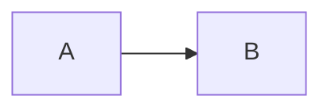

# Unit N — <the big question of the unit, as a question>

Lectures: [Lx <title>](https://youtu.be/<id>) · ... (book: chapters and pages)
Revision sheet: [[U0N <short name> - Revision]] · Course map: [[Courses/<Course>/Overview]]

> **How to read this note.** Each section starts from a puzzle. A naive answer comes first and breaks, then a better one, then the real mechanism. Wrong models are marked ❌. Timestamps like ▶ 15:39 jump to the lecture moment. Anything not said in the lectures sits in a box marked **Beyond lecture**.

### Mini-glossary (read once, the brackets below repeat it)
- **Term** (plain-language meaning in brackets)

---

## 1. <Topic question, never a method label like "Naive model">

**The puzzle.** <the confusion or need that makes the idea necessary> ▶ [mm:ss](https://youtu.be/<id>?t=<seconds>)

❌ **Naive model 1: "<plausible wrong idea>"** <why it breaks, concretely>

**Better model 2: <name>.** <mechanism, with an analogy and a concrete example>

> **Pause:** <a prediction question>. (Answer: <short answer>.)

> **Beyond lecture.** <standard exam material the lecture does not teach>

<formula last, after the mechanism is clear>

**The new puzzle this leaves:** <hook into the next section>

---

(3-8 sections like this; a short "Teacher / Me" dialogue where it helps:)

> **Teacher:** <question>
> **Me:** <naive answer>
> **Teacher:** <the push that breaks it>

---

## Closing the loop

<answer the opening question as a numbered chain of the unit's ideas>

**In one sentence:** <the unit's core insight>

**Still open:** <what this unit leaves unexplained> → [[U0(N+1) <short name> - Intuition]]

> **Accuracy notes.** <caption quality per lecture; which numbers were rebuilt from standard facts; caption fixes ("Bros 5000" = Burroughs B5000); items marked "own arithmetic">

<!--
Rules:
- 1-3 Pause boxes per unit; headings are topic questions; formula after mechanism.
- Bracket-explain each technical term on first use in each section.
- ▶ timestamps only for what the lecturer says: [mm:ss](https://youtu.be/<id>?t=<seconds>), seconds = mm*60+ss.
- Last unit: replace "Still open" with a whole-course recap table and "Back to the course map".
-->
